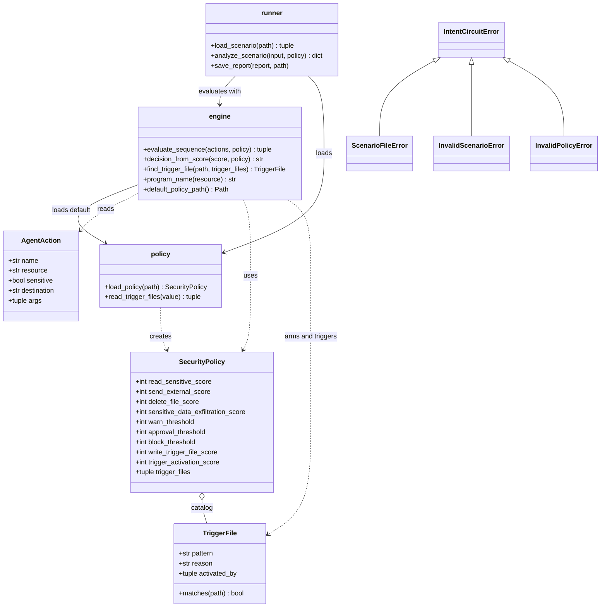

# IntentCircuit Architecture

## 1. Purpose

IntentCircuit is a security layer that sits between an AI coding agent and its
tools. It evaluates the sequence of actions an agent performs and decides
whether to allow, warn, require human approval, or block.

Long-term focus: detecting agents that try to leave their sandbox, including
indirect escapes where the agent writes a file that an unsandboxed host
component later executes.

## 2. Requirements

### In scope (current version)

- Represent agent actions: name, resource, sensitivity, destination, command arguments
- Understand file reads, sends, deletions and writes, commands with their arguments, and network requests
- Evaluate an ordered sequence of actions and remember earlier actions
- Calculate a risk score from 0 to 100 and map it to `ALLOW`, `WARN`, `APPROVAL` or `BLOCK`
- Detect writes to execution-trigger files from a catalog in the policy
- Remember which trigger files the agent wrote, and detect when the agent then runs the program that executes them (a trap that is set and then triggered)
- Load scores, thresholds and the trigger-file catalog from a JSON policy; the policy path is configurable through an environment variable
- Read scenarios from JSON and write a JSON report
- Reject invalid or unknown input (fail closed) with a clear message and exit code 1
- Run the automated tests on every pull request

### Planned (see the roadmap)

- Judge commands by their arguments, not only their name (`git -c core.fsmonitor`, the Docker socket, cloud metadata)
- Real-time, step-by-step decisions through an agent hook
- A benchmark against sandbox-escape techniques documented in 2026

### Out of scope

- Replacing the sandbox (Docker, gVisor, microVMs). IntentCircuit is an extra layer, not isolation.
- Kernel-level monitoring (system calls, eBPF). Runtime tools such as Falco already cover this.
- Detecting prompt injection in text. IntentCircuit judges actions, not prompts.
- A graphical dashboard.

## 3. Entities

| Entity | What it represents | Where |
|---|---|---|
| `AgentAction` | One step an agent wants to perform | `engine.py` |
| `SecurityPolicy` | The scores, thresholds and trigger-file catalog an organization chooses | `policy.py` |
| `TriggerFile` | A file that another program runs automatically, why it is dangerous, and which programs run it | `policy.py` |
| Scenario | A named, ordered list of actions | loaded by `runner.py` from JSON |
| Decision | Decision level, risk score and reason | returned by `evaluate_sequence` |
| Report | Scenario, actions, decision and timestamp | written by `runner.py` |
| `IntentCircuitError` and subclasses | Expected, explainable failures | `errors.py` |

## 4. Relationships

- A scenario contains one or more actions, in order. Order matters: the same actions in a different order can carry a different risk.
- One policy is used for the whole scenario. The policy owns the trigger-file catalog.
- While evaluating, the engine keeps two memories: sensitive files that were read, and trigger files the agent wrote ("armed traps").
- Evaluating a scenario produces exactly one decision; the report wraps it with the original actions.
- An error stops the evaluation; no partial report is written.

## 5. Class and module diagram

## 6. Data flow

1. `runner` reads the scenario JSON and validates every action. Unknown or malformed actions are rejected.
2. `policy` loads and validates the security policy, including the trigger-file catalog.
3. `engine` walks through the actions in order. It remembers which sensitive resources were read and which trigger files the agent wrote.
4. A write to a trigger file adds risk. Running a program that executes a trigger file the agent wrote earlier adds more risk.
5. The score is capped at 100 and mapped to a decision using the policy thresholds.
6. `runner` saves the report to `reports/latest_report.json`.

## 7. Decisions and trade-offs

| Decision | Why | Trade-off |
|---|---|---|
| Rules and policy, not a machine-learning model | Security decisions must be predictable, explainable and testable | Misses patterns that no rule describes; rules need maintenance |
| Analyze the sequence, not single actions | Real attacks combine steps that are each allowed | The engine must keep state across actions |
| Fail closed on unknown actions | A guard must not approve what it does not understand | New legitimate tools are blocked until they are added |
| Four decision levels | Blocking everything makes the agent useless; allowing everything is unsafe | Thresholds need tuning for each organization |
| Policy in JSON, path from an environment variable | Each organization sets its own risk level without code changes | Policy files must be validated (done in `policy.py`) |
| A confirmed leak sets the score to the maximum instead of adding to it | A confirmed leak is always the worst case, whatever came before | Less detail between very risky sequences |
| Frozen dataclasses for actions | The action history cannot be changed after the fact | Changing data requires creating new objects |
| Standard library only at runtime | Easy to install and audit; small attack surface | More code written by hand, such as validation |
| Writing an execution-trigger file needs approval, not an automatic block | Developers sometimes ask an agent to set up editor tasks or CI on purpose | A person must review each such write |
| The trigger-file catalog lives in the policy, not in the code | Each organization can add the files its own tools run | A file missing from the catalog is a blind spot |
| Writing a trigger file and then running the program that executes it is blocked | Setting a trap and then triggering it shows intent, not an accident | A legitimate "add a hook, then commit" flow is blocked and must be done by a person |
| Paths and program names are normalized before matching (slashes, letter case, `./`, `.exe`) | Otherwise an agent could bypass a rule by rewriting a name | Matching is less strict than an exact comparison |
| Editor-run files (`.vscode`, `.venv`) have no activating program | The user's editor, not the agent, runs them, so there is no activation step to observe | For these files only the write itself is flagged |

## 8. Threat model: sandbox escape

**Assets:** the host machine, credentials (cloud metadata, tokens), the repository and the CI pipeline.

**Attacker:** a coding agent whose instructions were manipulated, for example by text hidden in a README or an issue, or an agent that pursues its goal too aggressively.

**Escape paths documented in July 2026:**

| Path | Example | Why ordinary permissions miss it |
|---|---|---|
| Execution-trigger file | The agent writes `.vscode/tasks.json`; the editor runs it outside the sandbox | Writing files in the project is allowed |
| Git configuration | `core.fsmonitor` or hooks run a command | `git` is on the safe-command list |
| Agent hook configuration | A workspace hook file runs a command unsandboxed (CVE-2026-48124) | The file looks like ordinary configuration |
| Python environment | The agent modifies a `.venv` interpreter that an unsandboxed extension runs | It is a normal development file |
| Docker socket | Access to `/var/run/docker.sock` gives control of the host | The socket is reachable from the sandbox |
| Cloud metadata | A request to `169.254.169.254` returns credentials | It looks like an ordinary network request |

**What IntentCircuit sees:** every action the agent asks its tools to perform, with its arguments and its order.

**What it does not see:** what a process does after it starts, the content of the files the agent writes, actions that bypass the tool interface, and kernel-level activity. These remain the job of the sandbox and of runtime monitoring.

## 9. Related work

- **Invariant Guardrails:** open-source rules over sequences of tool calls. IntentCircuit focuses on escape intent, especially indirect escape through execution-trigger files.
- **Pillar Security:** commercial monitoring of the handoff between agent-written files and the host components that run them.
- **Sandboxes** (Docker, gVisor, Firecracker): isolation. IntentCircuit is a layer above them, not a replacement.

Sources: [Pillar Security – The week of sandbox escapes](https://pillar.security/blog/the-week-of-sandbox-escapes) · [Docker – Agent security is a systems problem](https://www.docker.com/blog/ai-agent-security-systems-problem/) · [Invariant Guardrails](https://github.com/invariantlabs-ai/invariant)