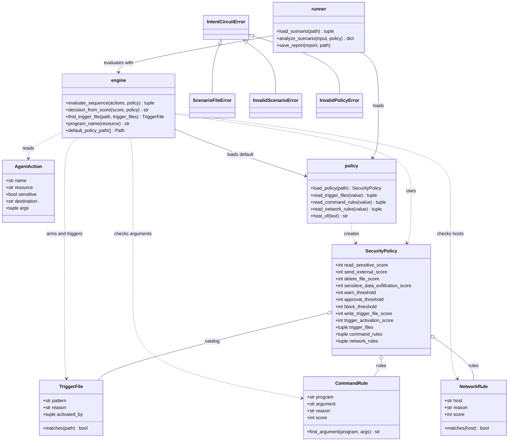

# IntentCircuit Architecture

## 1. Purpose

IntentCircuit is a security layer that sits between an AI coding agent and its
tools. It evaluates the sequence of actions an agent performs and decides
whether to allow, warn, require human approval, or block.

Long-term focus: detecting agents that try to leave their sandbox, including
indirect escapes where the agent writes a file that an unsandboxed host
component later executes.

## 2. Requirements

### In scope (current version)

- Represent agent actions: name, resource, sensitivity, destination, command arguments
- Understand file reads, sends, deletions and writes, commands with their arguments, and network requests
- Evaluate an ordered sequence of actions and remember earlier actions
- Calculate a risk score from 0 to 100 and map it to `ALLOW`, `WARN`, `APPROVAL` or `BLOCK`
- Detect writes to execution-trigger files from a catalog in the policy
- Remember which trigger files the agent wrote, and detect when the agent then runs the program that executes them (a trap that is set and then triggered)
- Judge commands by their arguments, not only their name: Git settings that run programs (`core.fsmonitor`, `core.hooksPath`, `core.sshCommand`), the Docker socket, privileged containers, setuid, `sudo` and `mount`
- Detect requests to cloud metadata services, both as network requests and as addresses inside commands such as `curl`
- Load scores, thresholds, the trigger-file catalog, command rules and network rules from a JSON policy; the policy path is configurable through an environment variable
- Read scenarios from JSON and write a JSON report
- Reject invalid or unknown input (fail closed) with a clear message and exit code 1
- Run the automated tests on every pull request
- Measure the engine against a labelled benchmark of escapes and ordinary developer work
- Decide before each tool call of a live Claude Code agent, through a `PreToolUse` hook, with memory per session and an audit log
- Replay the audit log as a timeline, and decide it again with another policy

### Planned (see the roadmap)

- Finer Git hook activation (a `pre-commit` hook runs on `git commit`, not on every `git` command)

### Out of scope

- Replacing the sandbox (Docker, gVisor, microVMs). IntentCircuit is an extra layer, not isolation.
- Kernel-level monitoring (system calls, eBPF). Runtime tools such as Falco already cover this.
- Detecting prompt injection in text. IntentCircuit judges actions, not prompts.
- A graphical dashboard.

## 3. Entities

| Entity | What it represents | Where |
|---|---|---|
| `AgentAction` | One step an agent wants to perform | `engine.py` |
| `SecurityPolicy` | The scores, thresholds, trigger-file catalog and rules an organization chooses | `policy.py` |
| `TriggerFile` | A file that another program runs automatically, why it is dangerous, and which programs run it | `policy.py` |
| `CommandRule` | A program, a dangerous argument pattern, the reason and its own score | `policy.py` |
| `NetworkRule` | A dangerous host, the reason and its own score | `policy.py` |
| Scenario | A named, ordered list of actions | loaded by `runner.py` from JSON |
| Decision | Decision level, risk score and reason | returned by `evaluate_sequence` |
| Report | Scenario, actions, decision and timestamp | written by `runner.py` |
| `IntentCircuitError` and subclasses | Expected, explainable failures | `errors.py` |

## 4. Relationships

- A scenario contains one or more actions, in order. Order matters: the same actions in a different order can carry a different risk.
- One policy is used for the whole scenario. The policy owns the trigger-file catalog, the command rules and the network rules.
- While evaluating, the engine keeps two memories: sensitive files that were read, and trigger files the agent wrote ("armed traps").
- Evaluating a scenario produces exactly one decision; the report wraps it with the original actions.
- An error stops the evaluation; no partial report is written.

## 5. Class and module diagram

## 6. Data flow

1. `runner` reads the scenario JSON and validates every action. Unknown or malformed actions are rejected.
2. `policy` loads and validates the security policy, including the trigger-file catalog and the command and network rules.
3. `engine` walks through the actions in order. It remembers which sensitive resources were read and which trigger files the agent wrote.
4. A write to a trigger file adds risk. Running a program that executes a trigger file the agent wrote earlier adds more risk.
5. Every command is checked against the command rules (by its arguments) and the network rules (by any address in its arguments). Every network request is checked against the network rules.
6. The score is capped at 100 and mapped to a decision using the policy thresholds.
7. `runner` saves the report to `reports/latest_report.json`.

## 7. Decisions and trade-offs

| Decision | Why | Trade-off |
|---|---|---|
| Rules and policy, not a machine-learning model | Security decisions must be predictable, explainable and testable | Misses patterns that no rule describes; rules need maintenance |
| Analyze the sequence, not single actions | Real attacks combine steps that are each allowed | The engine must keep state across actions |
| Fail closed on unknown actions | A guard must not approve what it does not understand | New legitimate tools are blocked until they are added |
| Four decision levels | Blocking everything makes the agent useless; allowing everything is unsafe | Thresholds need tuning for each organization |
| Policy in JSON, path from an environment variable | Each organization sets its own risk level without code changes | Policy files must be validated (done in `policy.py`) |
| A confirmed leak sets the score to the maximum instead of adding to it | A confirmed leak is always the worst case, whatever came before | Less detail between very risky sequences |
| Frozen dataclasses for actions | The action history cannot be changed after the fact | Changing data requires creating new objects |
| Standard library only at runtime | Easy to install and audit; small attack surface | More code written by hand, such as validation |
| Writing an execution-trigger file needs approval, not an automatic block | Developers sometimes ask an agent to set up editor tasks or CI on purpose | A person must review each such write |
| The trigger-file catalog lives in the policy, not in the code | Each organization can add the files its own tools run | A file missing from the catalog is a blind spot |
| Writing a trigger file and then running the program that executes it is blocked | Setting a trap and then triggering it shows intent, not an accident | A legitimate "add a hook, then commit" flow is blocked and must be done by a person |
| Paths and program names are normalized before matching (slashes, letter case, `./`, `../`, `//`, `.exe`) | Otherwise an agent could bypass a rule by rewriting a name | Matching is less strict than an exact comparison |
| Editor-run files (`.vscode`, `.venv`) have no activating program | The user's editor, not the agent, runs them, so there is no activation step to observe | For these files only the write itself is flagged |
| Commands are judged by their arguments, not only their name | `git` was on the safe-command list in a 2026 escape; one argument made it run the agent's program | Rules must list dangerous arguments, and new tricks need new rules |
| Each command and network rule carries its own score | Risks differ: `sudo` can be legitimate (approval), the Docker socket almost never is (block) | More numbers to tune in the policy |
| Argument patterns match both temporary and permanent forms (`*core.fsmonitor*`) | `git -c core.fsmonitor=...` and `git config core.fsmonitor ...` are the same attack | A harmless command that mentions the setting, such as unsetting it, also needs approval |
| Addresses are also checked inside command arguments | Agents usually reach the network with `curl`, not with a separate network action | Only addresses that appear as arguments are seen; an address built inside a script is not |
| Reconnaissance (`ls -la /`) adds no risk on its own | Agents explore their environment all the time for legitimate reasons | Early warning signs are not scored |
| The benchmark includes variants and ordinary work, not only documented escapes | Testing only the cases the rules were written for proves little | The reported numbers are lower |
| The benchmark is compared with a name-only permission list | A number means little without a baseline; this is the control the 2026 escapes went through | The baseline is our own simple model of such a list |
| Held-out cases are committed before fixes, and fixes come only from the variants | The Git history proves the held-out cases were not used to write rules | The honest number is low (3 of 9) |
| Addresses are written one way before matching (`2852039166` becomes `169.254.169.254`) | The same address has many spellings | Only decimal and standard IPv6 forms are handled so far |
| `env` is unwrapped and the program it starts is judged | `env VAR=... git` runs Git | Other wrappers (`nohup`, `sh -c`) are not unwrapped yet |
| The hook never answers `allow`; it answers `deny`, `ask` or nothing | `allow` would skip Claude Code's own permission checks | Ordinary actions still go through Claude Code's prompts |
| Any error in the hook answers `deny`, and the hook is configured with `onFailure: block` | A guard that crashes must not let the action through | A broken policy or state file stops the agent until it is fixed |
| Each session's history is saved to a file, and the session id is checked before it becomes a file name | Every hook call is a new process, so traps need memory; an id like `../../x` would write outside the folder | State files must be cleaned up; only letters, digits, `-` and `_` are accepted |
| A new action is judged only if it adds risk, but the decision uses the whole session's score | One risky step must not block all later ordinary work, and a sequence is riskier than a single step | Risk accumulates: after an approved risky step, a second risky step is blocked sooner |
| A blocked action is not remembered; an action that needed approval is | A blocked action did not happen | The hook cannot see whether the person approved |
| Shell redirects (`>`, `>>`) count as file writes | An agent can write a Git hook with `echo ... >` instead of a file tool | Writes inside scripts or `sh -c` strings are not seen |
| The audit log stores the actions, and replay decides them again with the same `decide` function | A policy change can be tested on real past sessions before it is used | Older log lines without actions cannot be decided again |
| Known misses and false alarms are listed in the tests | A new miss, or a fixed one, changes the list and must be noted on purpose | The list must be updated with every improvement |

## 8. Threat model: sandbox escape

**Assets:** the host machine, credentials (cloud metadata, tokens), the repository and the CI pipeline.

**Attacker:** a coding agent whose instructions were manipulated, for example by text hidden in a README or an issue, or an agent that pursues its goal too aggressively.

**Escape paths documented in July 2026:**

| Path | Example | Why ordinary permissions miss it |
|---|---|---|
| Execution-trigger file | The agent writes `.vscode/tasks.json`; the editor runs it outside the sandbox | Writing files in the project is allowed |
| Git configuration | `core.fsmonitor` or hooks run a command | `git` is on the safe-command list |
| Agent hook configuration | A workspace hook file runs a command unsandboxed (CVE-2026-48124) | The file looks like ordinary configuration |
| Python environment | The agent modifies a `.venv` interpreter that an unsandboxed extension runs | It is a normal development file |
| Docker socket | Access to `/var/run/docker.sock` gives control of the host | The socket is reachable from the sandbox |
| Cloud metadata | A request to `169.254.169.254` returns credentials | It looks like an ordinary network request |

**What IntentCircuit sees:** every action the agent asks its tools to perform, with its arguments and its order.

**What it does not see:** what a process does after it starts, the content of the files the agent writes, actions that bypass the tool interface, and kernel-level activity. These remain the job of the sandbox and of runtime monitoring.

## 9. Related work

- **Invariant Guardrails:** open-source rules over sequences of tool calls. IntentCircuit focuses on escape intent, especially indirect escape through execution-trigger files.
- **Pillar Security:** commercial monitoring of the handoff between agent-written files and the host components that run them.
- **Sandboxes** (Docker, gVisor, Firecracker): isolation. IntentCircuit is a layer above them, not a replacement.

Sources: [Pillar Security – The week of sandbox escapes](https://pillar.security/blog/the-week-of-sandbox-escapes) · [Docker – Agent security is a systems problem](https://www.docker.com/blog/ai-agent-security-systems-problem/) · [Invariant Guardrails](https://github.com/invariantlabs-ai/invariant)